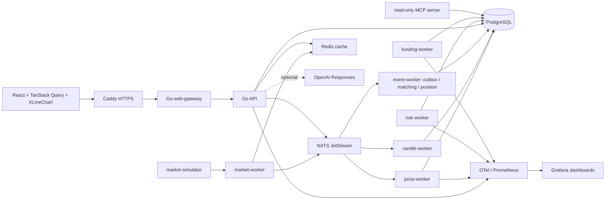

# v1.0 架构

## 运行结构

## 深模块边界

- `internal/trading`：不可变定点值对象与交易枚举，不依赖存储/网络。
- `internal/matching`、`position`、`margin`、`liquidation`、`funding`、`insurance`：纯领域计算，输入相同时结果确定。
- `internal/platform/postgres`：事务、锁、幂等和派生快照；不把 SQL 泄漏到 HTTP/UI。
- `internal/eventing`：versioned envelope、Outbox、JetStream stream/consumer、ACK/parking。
- `internal/httpserver`：严格解码、认证授权、精确十进制传输、脱敏错误。
- `internal/ai`、`readtools`：只读证据与审计边界；领域服务不依赖模型可用性。

## 数据所有权

PostgreSQL 拥有用户、订单、成交、仓位、保证金、账本、风险、结算和审计真值。Redis 只拥有有限 TTL 的缓存、登录限流和 denylist；清空后可以回源或失败关闭。JetStream 拥有待消费事件，不替代 PostgreSQL 事实。前端本地状态只用于交互和展示。AI 输出是可丢弃解释，不是交易真值。

## 一致性策略

下单/冻结/Outbox、撮合/成交/订单状态、成交结算/仓位/账本均在各自 Serializable PostgreSQL 事务内完成。跨事务通过至少一次事件、`processed_events`、业务唯一键和幂等键收敛。ACK 只能发生在数据库提交后。
