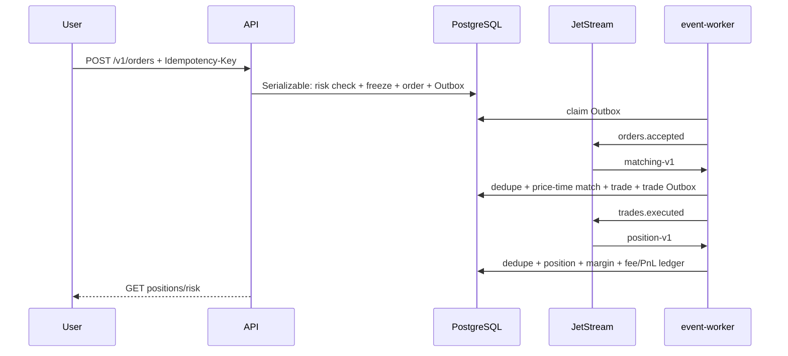
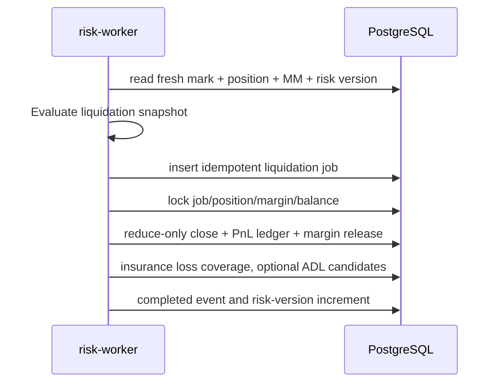

# 永续合约关键序列

## 下单、撮合与仓位



## 资金费

```mermaid
sequenceDiagram
  participant F as funding-worker
  participant P as PostgreSQL
  F->>P: lock funding timestamp and position snapshots
  P-->>F: mark/index, sizes, versions
  F->>F: exact signed payment + cap
  F->>P: one transaction: rate + settlements + ledger
  Note over F,P: residual one-sided exposure is offset by the simulated insurance fund
  F->>P: mark settled; repeat returns existing result
```

## 强平


